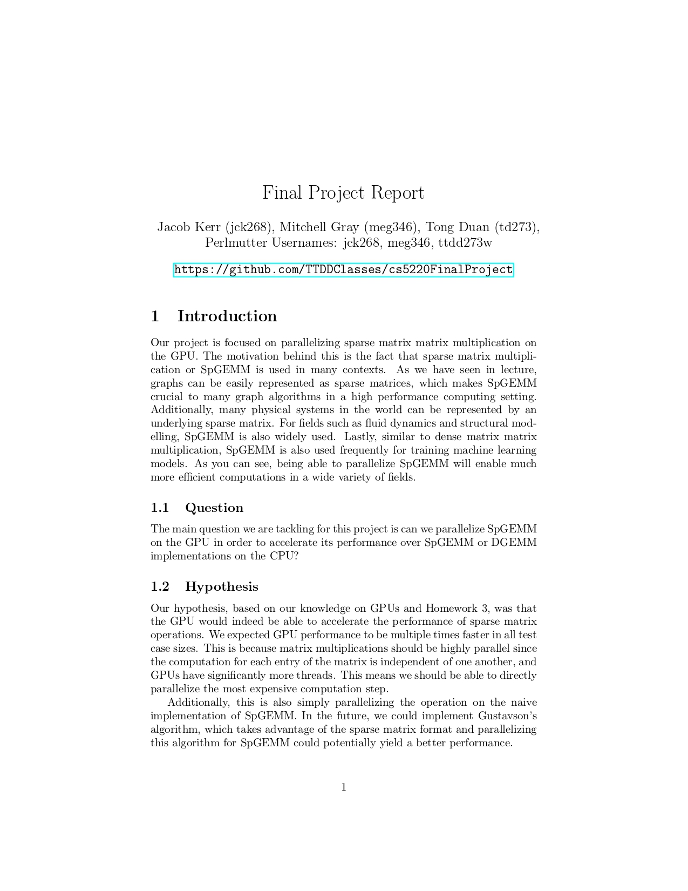
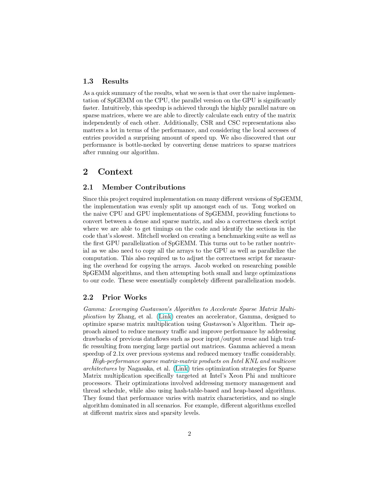
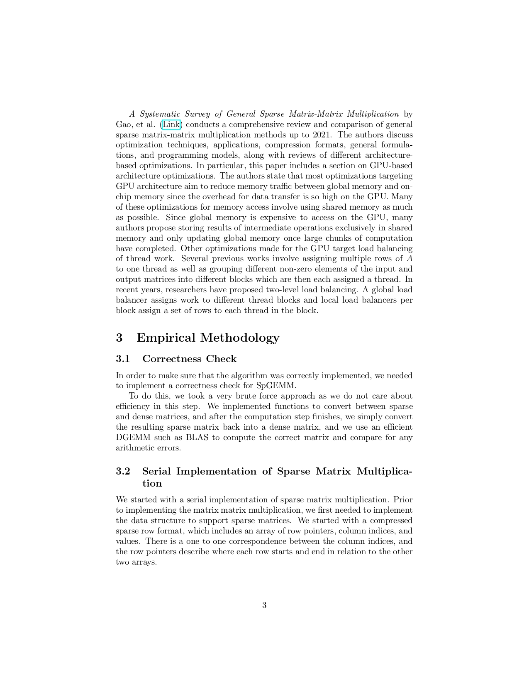
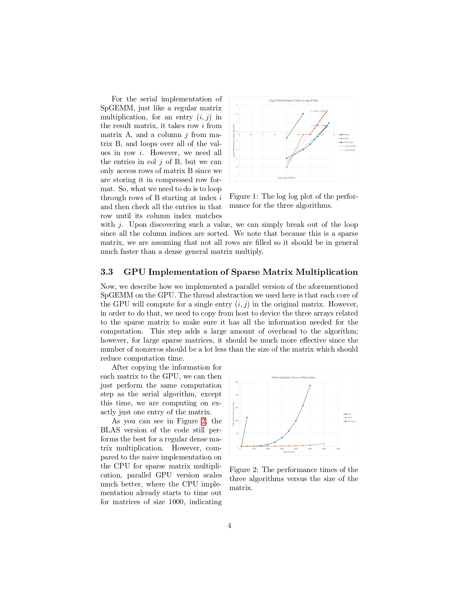
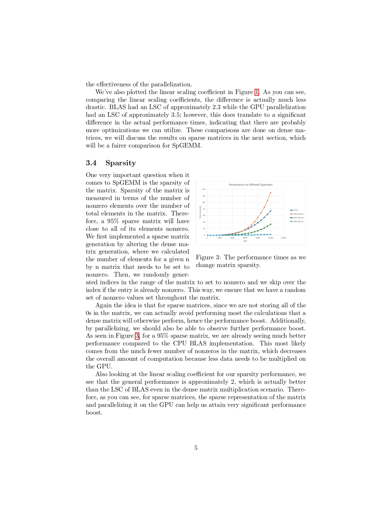
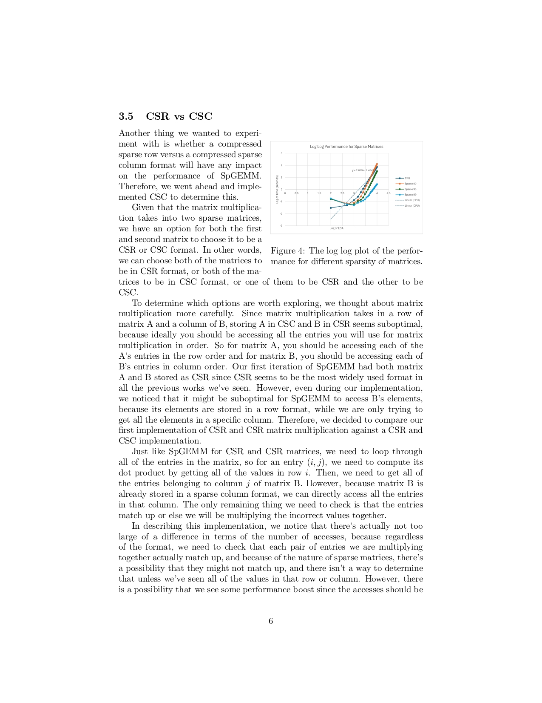
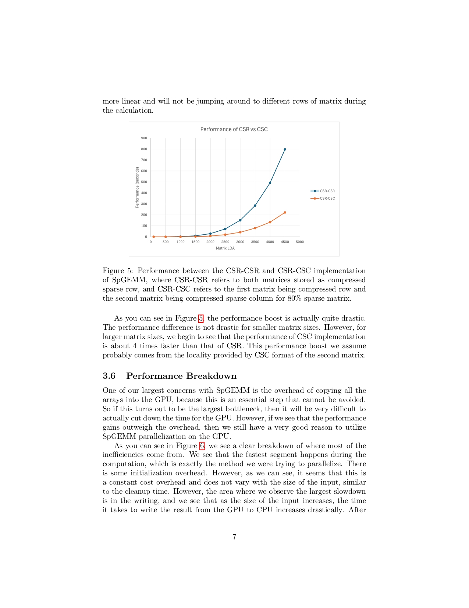
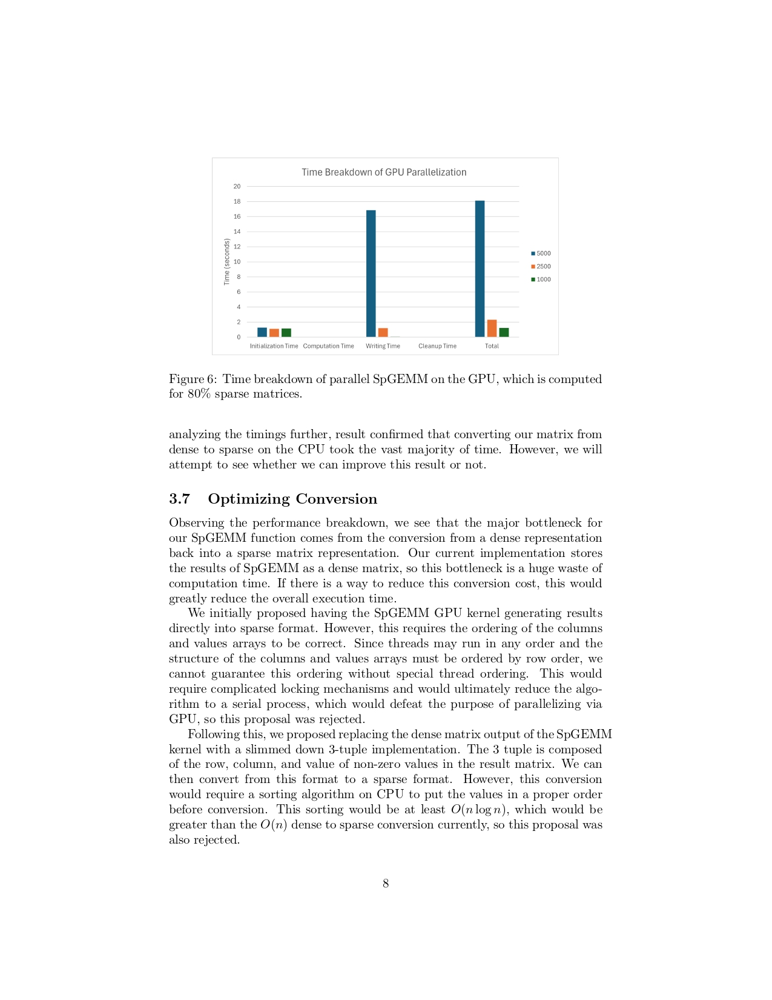
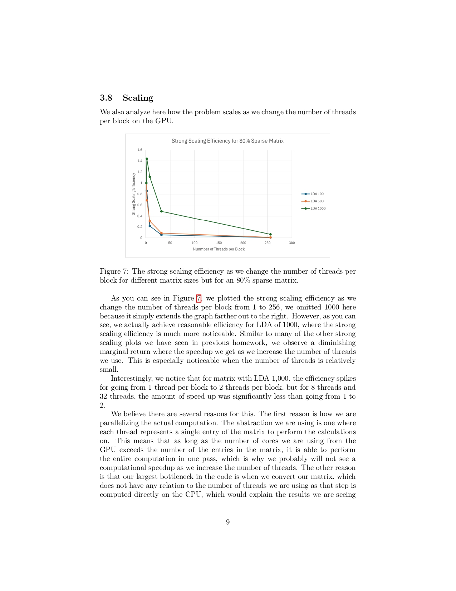
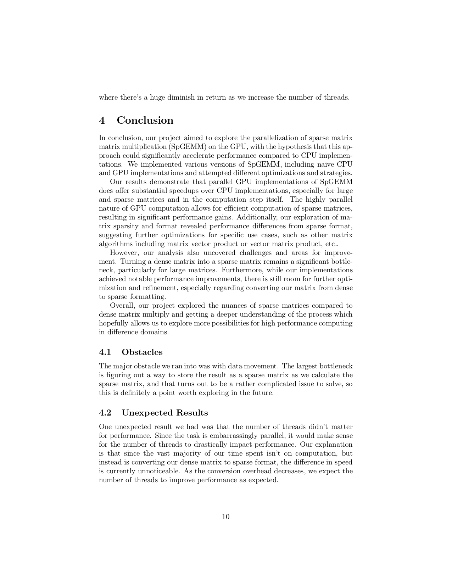

# cs5220FinalProject
Sparse Matrix Multiplication 

The Final Project for CS5220, where we try to implement sparse matrix multiplication.

This research used resources of the National Energy Research Scientific Computing Center, a Department of Energy Office of Science National User Facility using NERSC award NERSC DDR-ERCAP0027296.

